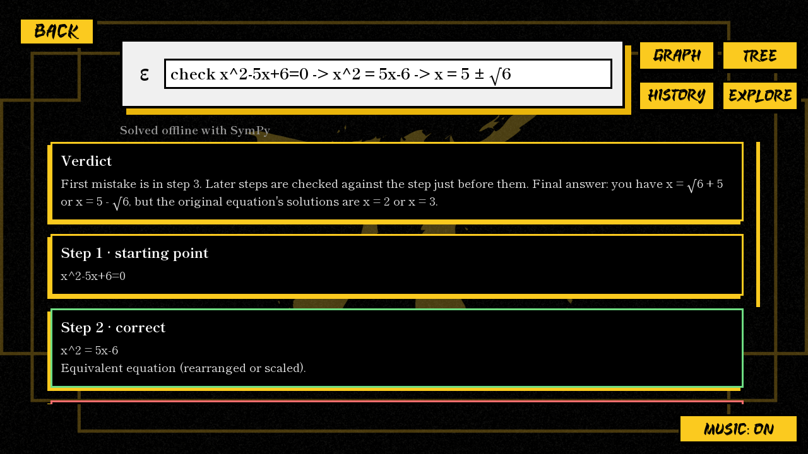
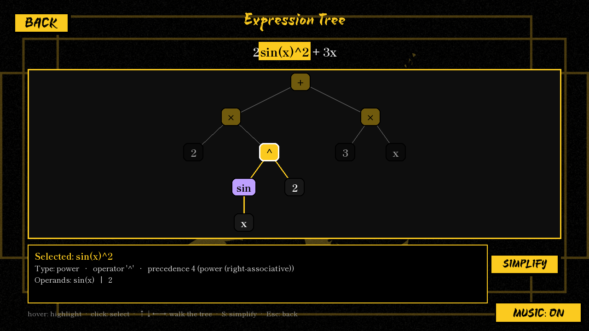
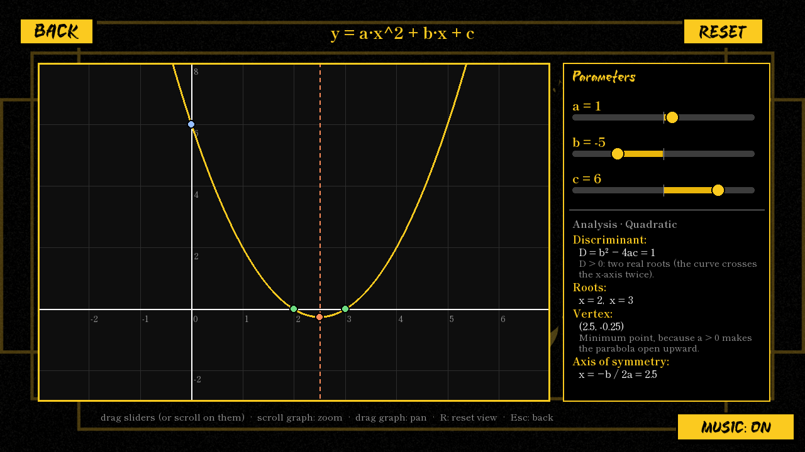

# πCore

**A mathematical computing and reasoning environment.** πCore computes answers, and it also
**reads** maths as a tree, **proves or checks** its results, and **finds the exact mistake** in
someone's working. It runs fully offline (SymPy), and Wolfram|Alpha is an optional extra for
word questions. It's styled gold on black, with music and loading lines like "Convincing π to
Terminate".



## Run

```bash
pip install -r requirements.txt
python -m picore        # or: python main.py
```

## What makes it different

### 1. Mistake Detective: *why* a step is wrong, not just *that* it's wrong

Write your working as steps joined by `->`:

```
check x^2-5x+6=0 -> x^2 = 5x-6 -> x = 5 ± √6
```

* Step 2 is **correct**: it's an equivalent equation.
* Step 3 is a **mistake**: square-rooting only gives x = ±√(5x − 6), which still contains x, and
  5 ± √6 are not solutions. Correct: x² − 5x + 6 = 0 → (x − 2)(x − 3) = 0 → x = 2 or x = 3.

Every step gets one of five verdicts: **correct** (verified symbolically), **numerically supported**
(agrees at every test point but not proved), **check needed** (valid only with care, such as
squaring both sides), **mistake here**, or **couldn't check**. A correct step is never called a
mistake on a guess.

πCore knows a catalogue of common misconceptions ("mal-rules") and only names one when
re-applying it to your previous step reproduces exactly what you wrote. That covers wrong
expansions, distribution and sign errors, invalid cancellation, exponent and log rules, terms
moved without changing sign, dividing by something that can be zero, ± roots, extraneous roots
from squaring, steps that lose part of the domain, and power, product, quotient and chain rule
slips. See the [full catalogue](docs/MISTAKES.md).

**Measured, not claimed.** A benchmark of 230 labelled steps ([docs/EVALUATION.md](docs/EVALUATION.md))
runs as part of the test suite:

| | |
|---|---|
| Correct steps flagged as mistakes | **0 of 107** |
| Wrong steps flagged | 115 of 117 (98.3%) |
| Expected misconception named | 87 of 87 |
| Wrong misconception named, or a cause invented | **0** |

It is an internal regression benchmark written for this project, not a study of real students.

You can label steps with the rule you used, and πCore checks that the rule really gives that result:

```
check (x+1)^2 -> [expand] x^2+2x+1 -> [d/dx] 2x+2 -> [sub x=1] 4
check x^2 -> [integrate] x^3/3          → missing the constant of integration (+ C)
```

### 2. Equivalence that understands domains

```
equiv (x^2-1)/(x-1) ; x+1      → Equivalent, with a domain restriction (x ≠ 1)
is ln(x^2) = 2ln(x)            → Equivalent where x > 0, proved under that assumption
compare sqrt(x^2) with x       → Not equivalent: at x = −5 the sides are 5 and −5
```

There are five possible verdicts: exact, conditional, numeric-only, not equivalent, and unable
to decide. Numerical agreement is always labelled as evidence, never as proof.

### 3. Verified results and derivations

Derivatives are checked against finite differences, integrals against differentiation and
numerical quadrature, and solutions by substituting them back. `derive (x+1)^2 : expand, d/dx,
sub x=1` produces a chain in which every step carries its verification status.

When an equation has no closed-form solution (`x^5 − x − 1 = 0`, `sin x = x/2`), πCore gives
numerical roots and says why. Periodic equations get every solution as a family
(`sin x = 1/2` → x = 2πn + π/6 or x = 2πn + 5π/6). It never claims "no solutions" unless that is
proved, and undefined values (`1/0`, `ln 0`) are reported as undefined.

### 4. See how it reads your maths: the expression tree

`tree 2sin(x)^2 + 3x` (or **TREE**, Ctrl+T) draws the syntax tree. Hover a node to highlight its
subtree and the matching characters of your input. Click it to see its operator, precedence,
operands and domain. Press **S** to simplify just that part, and the result is verified.



### 5. Explore parameters

`explore a x^2 + b x + c` (or **EXPLORE**, Ctrl+E) gives sliders for each parameter. The graph,
roots, vertex, discriminant and axis of symmetry update as you drag, with explanations like
"D < 0: the curve never meets the x-axis". It also handles lines, sinusoids
(`A sin(B x + C) + D`) and any other function (numerical roots).



## Everything else

| Type this | You get |
|---|---|
| `2+2`, `5!`, `sqrt(8)`, `e^(i pi)` | exact result, decimal, prime factorization |
| `x^2 - 5x + 6` | factored/expanded form, derivative, roots |
| `2x + 3 = 7`, `x^2 = -1` | solutions (incl. complex), verified by substitution |
| `solve x+y=3 and x-y=1` | systems of equations |
| `d/dx sin(x)^2`, `derivative of x^3` | 1st and 2nd derivatives, numerically verified |
| `integrate x^2 from 0 to 3`, `integral of 1/x` | definite / indefinite integrals, verified |
| `limit sin(x)/x as x->0` | limits |
| `factor …`, `expand …`, `simplify …` | that transformation |

πCore has its own parser. The [grammar is documented](docs/GRAMMAR.md), including how it reads
ambiguous notation like `sin x^2`, `1/2x` and `-2^2`. Implicit multiplication (`2x`, `2(x+1)`,
`sin x`) and the symbols `π √ ² × ±` all work. Errors point to the exact character.

**GRAPH** (Ctrl+G) plots any one-variable expression: scroll to zoom, drag to pan, hover to
trace, and press R to reset.

**HISTORY** (Ctrl+H) lists past queries. Click a card to expand it, or click RUN to re-open it.

In the input box, ↑/↓ recalls previous inputs, Esc clears, and Ctrl+V pastes.

## How it's built

See [docs/ARCHITECTURE.md](docs/ARCHITECTURE.md). In short:

```
text → lexer → recursive-descent parser → AST (with spans + domain analysis)
     → SymPy computation → reasoning (equivalence · mal-rules · derivations)
     → verification (symbolic proof, numerical evidence) → Pygame UI
```

## Word questions (optional Wolfram|Alpha)

Anything SymPy can't parse (e.g. "distance to the moon") is sent to Wolfram|Alpha,
but only if an AppID is configured. Set it with any one of these:

1. Environment variable `PICORE_WOLFRAM_APPID`
2. `config.json` in the user data folder (`%APPDATA%\PiCore` on Windows): `{"wolfram_app_id": "…"}`
3. `picore.config.json` next to `main.py` (git-ignored, for development)

Or use a proxy instead of an AppID: `PICORE_WOLFRAM_PROXY` / `"wolfram_proxy_url"` (see [proxy/](proxy/README.md)).

Never commit the AppID. Before a public release, route Wolfram calls through a
small server you control so the key is not shipped inside the app.

## Build the Windows app

```bash
pip install pyinstaller
powershell -ExecutionPolicy Bypass -File packaging/build.ps1
```

This runs the tests, builds `dist\PiCore\PiCore.exe`, checks that no API key file got bundled,
and self-tests the exe. If [Inno Setup 6](https://jrsoftware.org/isinfo.php) is installed
(`winget install JRSoftware.InnoSetup`), it also produces `dist\PiCore-Setup-<version>.exe`.

For a public release, deploy the proxy in [`proxy/`](proxy/README.md) and set `wolfram_proxy_url`,
so the AppID stays on the server.

## Data and logs

History is stored in SQLite at `<user data folder>/history.db` (`%APPDATA%\PiCore` on Windows), and
settings (music on/off) in `config.json` in the same folder. No database server is needed. If the
history file is ever damaged, it is moved aside and a fresh one is started; the app keeps running.

Internal errors are written with tracebacks to `picore.log` in the same folder (rotated, at most
about 1.5 MB). Nothing secret is logged.

Background music is optional and not included in the repository. Put a track you have the rights
to at `assets/bgmusic.mp3` and the app plays it; without it, the app runs silently.

## Conventions and limitations

* `log` means the natural logarithm (use `log10` for base 10). Angles are in radians. Equations
  are solved over the reals and complex numbers. Under `d/dx`, other letters are constants.
* Numerical root search covers [−20, 20] and can miss roots closer together than 0.01. Results
  from it are always labelled as numerical.
* The Mistake Detective models one misconception per step. Multi-variable equations are only
  checked for simple rearrangements, and otherwise reported as "couldn't check".
* Integer powers of symbolic expressions are limited to 200, and inputs to 300 characters per
  expression, so that no input can hang the app.
* Background jobs have a 25 s timeout. Python cannot stop a thread, so a runaway computation
  keeps using CPU until it finishes, but its result is discarded.

## Security

* Maths input is parsed by Pi Core's own grammar. It never reaches `eval`/`exec`, and code-like
  input is tested to never run (`tests/test_robustness.py`).
* The Wolfram|Alpha AppID is read from the environment or a git-ignored config file. It is never
  in the source, the git history or the built `.exe` (the build script checks for this). For
  public builds, use the [proxy](proxy/README.md) so the key stays on a server.
* Responses from Wolfram|Alpha are treated as untrusted: their structure and size are validated.

## Project layout

```
main.py               entry point (also: python -m picore)
picore/
  lang/               lexer, recursive-descent parser, AST, SymPy backend, domain analysis
  reasoning/          equivalence, numerical verification, derivations
    mistakes/         Mistake Detective rule catalogue (algebra, equations, calculus, trig)
  engine/             command routing, SymPy commands, checker, optional Wolfram client
  explore.py          parameter experiments and analyzers
  scenes/             loading, menu, calculator, graph, tree, explore, history
  ui/                 theme, fonts, widgets, reusable plot
  app.py worker.py storage.py config.py paths.py
assets/               backgrounds, logo, music, fonts
docs/                 ARCHITECTURE, GRAMMAR, MISTAKES, EVALUATION, PORTFOLIO, screenshots,
                      original-school-synopsis.docx (where the project started)
tests/                pytest suite (340 tests) + data/detective_corpus.json
tools/                evaluate_detective.py (the benchmark)
packaging/            PyInstaller spec, Inno Setup script, build.ps1
proxy/                Cloudflare Worker that hides the Wolfram AppID
```

## Tests

```bash
pip install -r requirements-dev.txt
python -m pytest
```

## Fonts

| Use | Font | Licence |
|---|---|---|
| Titles and buttons | Shotengai Demo (if present), otherwise Yuji Syuku | Shotengai: personal use only. Yuji Syuku: SIL OFL |
| Text and results | Shippori Mincho | SIL OFL |
| Greek letters and maths symbols | STIX Two Math | SIL OFL |

The OFL fonts are subset to the characters the app uses, and their licences are in `assets/fonts/`.
`ShotengaiDemo.otf` is git-ignored and left out of builds by default. Set `PICORE_PERSONAL_BUILD=1`
to include it in a build for your own machine; buy the full licence before distributing it.
