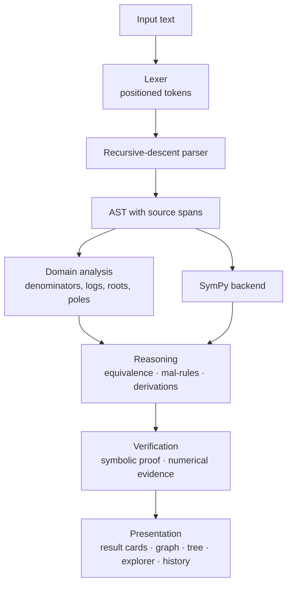
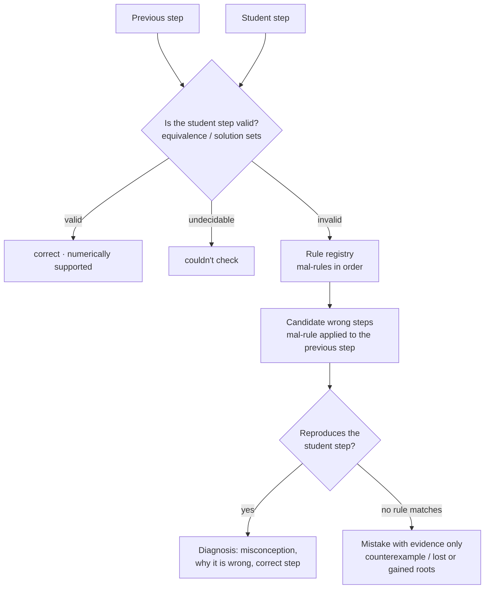

# Pi Core architecture

Pi Core is a mathematical computing and reasoning environment. It computes answers, and it also
**understands** expressions (as trees), **verifies** results, and **diagnoses** mistakes in
someone's working. This document explains how the pieces fit and how to extend them.

```
                         PI CORE
                            │
            ┌───────────────┴───────────────┐
            │                               │
       INPUT LAYER                     COMPUTATION
   picore/lang/                    picore/engine/
   lexer → parser → AST            local.py (SymPy, offline)
   domain analysis                 wolfram.py (optional, online)
            │                               │
            └───────────────┬───────────────┘
                            │
                     REASONING LAYER   picore/reasoning/
          ┌─────────────────┼──────────────────┐
          │                 │                  │
     equivalence.py   mistakes/ (mal-rules)  derivation.py
          │                 │                  │
          └─────────────────┼──────────────────┘
                            │
                      VERIFICATION    reasoning/numeric.py
                  symbolic proof  +  numerical evidence
                            │
                      PRESENTATION    picore/scenes/ + picore/ui/
          ┌────────┬────────┼─────────┬──────────┐
       Calculator  Graph   Tree     Explorer   History
                            │
                   Pygame (one window, one process)
```

## Diagrams

**System architecture**



**Mistake Detective**



**Calculation flow**

```mermaid
flowchart TD
    U[User input] --> P[Parser]
    P -- parsed --> L[Local engine: SymPy]
    L -- success --> R[Result cards + verification]
    L -- SymPy cannot finish --> W{Wolfram AppID<br/>or proxy set?}
    P -- looks like words --> W
    P -- malformed maths / too large --> X[Explained locally, never sent online]
    W -- yes --> WA[Wolfram|Alpha]
    W -- no --> O[Offline message]
```

## Layers

| Package | Responsibility | Depends on |
|---|---|---|
| `picore/lang` | Turn text into a structured, positioned AST. Grammar: [GRAMMAR.md](GRAMMAR.md). | nothing (the SymPy backend module is the only exception) |
| `picore/reasoning` | Decide equivalence, verify results, diagnose mistakes, run derivations. | `lang`, SymPy |
| `picore/engine` | Route a query to a command and return result cards (`Response`). Wolfram is used only for input the local engine can't parse. | `lang`, `reasoning` |
| `picore/explore.py` | Parameter experiments and analyzers (no UI). | `lang`, `reasoning.numeric`, SymPy |
| `picore/scenes`, `picore/ui` | Pygame screens and widgets. | everything above |
| `picore/worker.py` | Runs slow work off the render loop. The latest job wins, and errors become results. | stdlib |
| `picore/storage.py`, `config.py`, `paths.py`, `logs.py` | SQLite history (survives a damaged file), type-checked settings and secrets, asset paths (work when frozen), rotating error log. | stdlib |

Only the `scenes`/`ui` layer imports pygame. Everything below it is plain Python, and that's
why it is all unit-tested directly.

## Data flow for one query

```
TextInput ──Enter──▶ CalcScene.submit
                          │  worker.submit("calc", engine.evaluate, text, …)
                          ▼                                   (background thread)
                 engine.evaluate(text)
                   ├─ local.compute(text)          command routing
                   │    ├─ check …   → engine/checker.py → reasoning/mistakes, derivation
                   │    ├─ equiv / derive → engine/reasoning_commands.py
                   │    ├─ solve / d/dx / integrate / limit / factor …  → SymPy
                   │    │        + Verification card from reasoning/numeric
                   │    └─ plain expression or equation
                   └─ on ParseError → wolfram.query (only if an AppID or proxy is configured)
                          ▼
                 Response(pods=[(title, text)…], source, plot_expr)
                          │  worker.poll() on the next frame
                          ▼
                 CardList (border colour = verdict) · saved to SQLite history
```

The render loop never waits on maths or the network. A 25-second timeout guards runaway
computations. Because only the latest job of each kind is delivered, a slow stale answer can
never overwrite a newer one.

## Key design decisions

**A native parser instead of `eval` or SymPy's parser.** Pi Core needs things a black-box parser
can't give it:
- **source spans**, to highlight subexpressions and point at errors
- **the structure as written**, because SymPy turns `2(x+3)` into `2x+6`, which hides what the
  student did
- **domain information**, because SymPy turns `x/x` into `1`

It also makes notation conventions such as `sin x^2` and `1/2x` explicit and tested.

**Domains come from the AST.** `domain_conditions` reads denominators, logs, roots and tan/cot
poles from the tree *before* SymPy simplifies anything. That is what lets the equivalence engine
say that `(x²−1)/(x−1)` equals `x+1` *only for x ≠ 1*.

**Symbolic proof first, numbers as evidence, with one exception.** There are three outcomes:
- **Proved:** an equality simplifies to 0 symbolically. Only this outcome is reported as proved.
- **Agreed numerically:** reported as "numerical evidence, not a proof", and shown with an amber
  card border.
- **Counterexample:** a numerical counterexample at a point where both sides are defined *is* a
  proof of non-equivalence. It is cheap, so it is tried first, which made the Mistake Detective
  about 25× faster on hard inputs.

**Mistakes are diagnosed with mal-rules, not guessed.** See below.

**Nothing is invented.** A derivation step that can't be verified is marked "could not be
verified". The detective explains a step only when a rule reproduces it. An equation with no
closed-form solution gets numerical roots and an explicit note, never "no solutions", unless that
is proved.

## The Mistake Detective

```
check  A -> B -> [rule] C -> …

for each consecutive pair (prev, cur):
    labelled step?  → derivation.TRANSFORMS[rule].verify(prev, cur)
    expressions?    → equivalence.compare(prev, cur)        exact / conditional / numeric / not / unknown
                      (a rewrite is valid if it equals prev wherever prev is defined; a result
                       undefined somewhere prev was defined is a mistake: ln(x²) → 2 ln x)
    equations?      → 1. proportional residuals, only if neither side excludes extra points
                      2. exact solution sets (or their finite difference), domain-aware
                      3. otherwise real roots compared numerically ("numerically supported")
    if invalid:
        for rule in mistakes.RULES:            (specific misconceptions first)
            if rule.detect(prev, cur): report it: category, violated rule, correct step
        otherwise report the evidence (counterexample / lost roots) without guessing why
final answer compared with the first step (catches extraneous roots that survive)
```

A **mal-rule** encodes a misconception, for example `(a+b)² → a²+b²` or `(uv)′ → u′v′`. The
detective applies each mal-rule to the *previous* step, at every place in its tree where the rule
fits (`core.rewrite_each`). If a result matches what the student wrote, that misconception is
the diagnosis. Calculus works the same way: `calculus.differentiate` is a small AST
differentiator that can apply one wrong rule at one node, so it enumerates every derivative
reachable by a single mistake. The full catalogue is in [MISTAKES.md](MISTAKES.md).

Every step ends in one of five verdicts: **correct**, **numerically supported**, **check needed**
(valid with care, e.g. squaring), **mistake here**, **couldn't check**. Rule failures never crash a
check: a rule that raises is treated as not applying and the error is logged.

How well this works is measured on a 230-case labelled corpus: see [EVALUATION.md](EVALUATION.md).
The test suite fails if a correct step is ever flagged or a misconception is misattributed.

## Extension points

| To add… | Do this | Nothing else changes |
|---|---|---|
| a misconception | Subclass `RewriteRule` (implement `buggy(node)`) or `MalRule` (implement `detect(prev, cur)`) in `reasoning/mistakes/*.py` and decorate it with `@register`. Add a case to `tests/test_mistakes.py` and a row to `docs/MISTAKES.md` (a test checks the docs list every rule). | ✓ |
| a step rule / derivation operation | Add a `Transform(name, describe, apply, verify)` to `reasoning/derivation.py`. Its `verify` must be independent of `apply`. | ✓ |
| a kind of experiment | Subclass `Analyzer` in `explore.py` (`applies`, `analyze` returning facts, markers and guide lines) and add it to `SPECIFIC`. | ✓ |
| a function | Add it to `lexer.FUNCTION_NAMES` and `sympy_backend.FUNCTIONS`. Add domain rules in `domain_conditions` if needed. | ✓ |
| a screen | Subclass `Scene` (`enter`, `handle`, `update(dt)`, `draw`, optional `on_result`) and register it in `App.__init__`. | ✓ |

## Testing

`python -m pytest`. The suite has 340 tests, runs in about 1–2 minutes, and covers 87% of lines.
It runs on Windows and Linux in GitHub Actions.

| File | Covers |
|---|---|
| `test_lang.py` | tokens, every precedence convention, AST shape, spans, error positions, round-trip printing, a 3000-input fuzz test, domains |
| `test_reasoning.py` | equivalence verdicts and restrictions, numerical verification, derivations |
| `test_mistakes.py` | each rule against its classic error, and valid steps that must *not* be flagged |
| `test_engine.py`, `test_checker.py` | commands; the honesty rules (no false "no solutions") |
| `test_explore.py` | analyzers |
| `test_scenes.py` | every screen driven headlessly with real keyboard and mouse events |
| `test_worker.py` | concurrency guarantees, plus a performance budget for the detective |
| `test_storage.py`, `test_wolfram.py` | SQLite history; the Wolfram client against a fake proxy |
| `test_math_regression.py` | algebra, equations (repeated, complex, periodic, unsolvable), calculus, limits, domains, equivalence |
| `test_robustness.py` | property tests on random syntax trees, pathological and code-injection input, time bounds |
| `test_detective_corpus.py` | the Mistake Detective benchmark and its guarantees |
| `test_docs.py` | the rule catalogue and grammar docs match the code |

## Known limitations

- **Equations:** the detective reasons about single-variable equations through solution sets.
  Multi-variable steps are checked only for proportionality, and otherwise reported as "couldn't
  check".
- **Numbers:** solution sets are computed over ℂ, but excluded points come from real-valued
  domain rules.
- **Integration:** there is no `∫` syntax inside `check` steps yet. Use the `[integrate]` label,
  which also detects a missing `+ C`.
- **Numerical root scans** cover [−20, 20] only, can miss roots closer than the 0.01 grid, and say so.
- **Threads cannot be killed:** a computation past the 25 s timeout is abandoned (its result is
  discarded) but keeps using CPU until it ends. Input size limits keep this rare.
